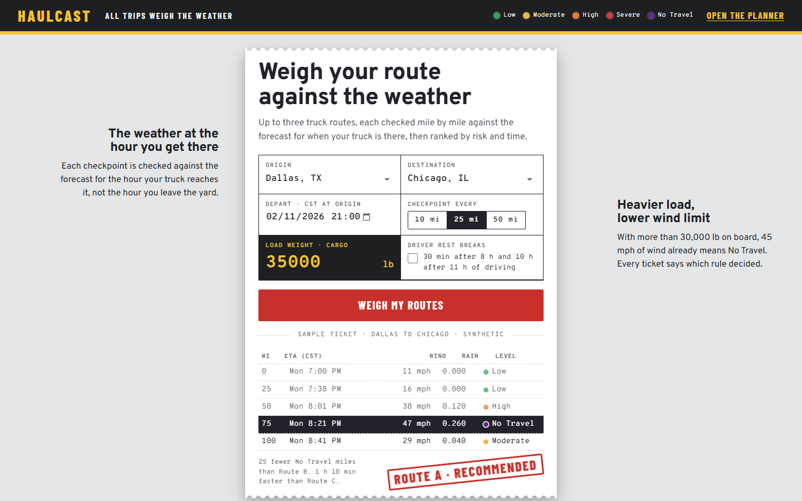
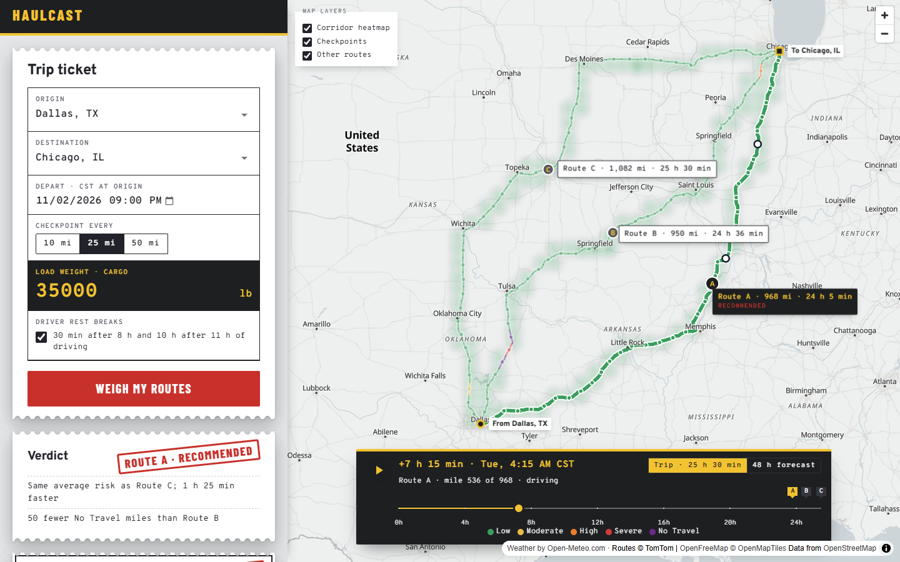

<p align="center">
  
</p>

<h1 align="center">Haulcast</h1>

<p align="center">
  <strong>Weigh your route against the weather.</strong><br>
  Compare truck routes by the weather the truck will actually meet, stretch by stretch.
</p>

<p align="center">
  <a href="https://haulcast.sebdavid.dev/"><strong>Try it live</strong></a> ·
  <em>Walkthrough video (Loom link coming)</em> ·
  <a href="docs/weather-risk-decisions.md">How it decides</a>
</p>



## Why I built it

Most weather apps answer "what's the weather now?" A truck leaving Dallas tonight doesn't care about Chicago's weather now. It cares about Chicago's weather tomorrow morning, when it gets there, and about every stretch in between.

Haulcast plans up to three truck routes, works out when the truck reaches each checkpoint, checks the forecast for that place at that hour, and recommends the safest route. It also tells you **why**: "same Severe miles as Route B, 25 fewer High miles." I started it as a full-stack challenge (React + Django) and kept going until it felt like something a dispatcher could actually use.



## What you can do with it

- **Plan a trip** from any US place to another, with a departure time on the origin's clock and your cargo weight.
- **Compare three truck routes**, each split into the stretch around every checkpoint (every 10, 25 or 50 miles) and colored from Low to No Travel.
- **See why one route wins.** The verdict names the criterion that decided against each other route.
- **Watch the trip play out.** The slider moves each truck along its route on schedule, while a heatmap shows the risk along the corridor hour by hour, up to 48 hours ahead.
- **Add driver rest breaks.** The federal hours-of-service stops (30 min after 8 h, 10 h after 11 h of driving) move later checkpoints into different weather, and sometimes change the winner.
- **Account for the load.** Heavy trucks get stricter wind limits: over 30,000 lb, 45 mph is No Travel.

## How it works

1. **Routes:** TomTom's routing API in truck mode returns up to three distinct routes. Near-copies are swapped for real detours.
2. **Checkpoints:** one at the origin, one every N miles, one at the destination. Each gets an arrival time from the route's own travel times, plus rest stops when you include them.
3. **Forecast:** Open-Meteo's hourly forecast for that place at that hour: sustained wind, rain and snow.
4. **Risk:** each checkpoint is classified with the threshold table and the load rules, and takes the worst of its conditions.
5. **Verdict:** routes are ranked by No Travel miles, then Severe, then High, then average risk, then travel time.

Long trips at 10-mile checkpoints need hundreds of forecast points. Instead of failing, the server paces its weather requests to the free plan's per-minute limit, and the planner shows the routes right away with a countdown while every stretch is checked.

## Decisions I had to make

The brief left a few things open. Every call is written down, with its reason and the tests that pin it, in [docs/weather-risk-decisions.md](docs/weather-risk-decisions.md). My favorites:

- **Rain is `rain + showers`, not `precipitation`.** I checked the API: `precipitation` already includes snow as water, so snow would count twice.
- **Which forecast hour?** Rain and snow are totals over the *previous* hour, so a truck at 10:20 uses the value stamped 11:00 (10 to 11). Wind is an instant reading, so it's interpolated.
- **Time zones.** The departure is read on the origin's clock, all math runs in UTC, and a test covers the daylight-saving change on November 1st. (The weather API applies one fixed UTC offset to a whole response, which would have shifted every hour after the change.)
- **Ranking at the precision you see.** Average risk is compared to one decimal, so when two routes look equally risky, travel time gets a say. No Travel miles rank first, because a route with No Travel must never win.

How the app stays inside the free API limits (cells, cache, pacing) is in [docs/api-usage.md](docs/api-usage.md).

## Tech stack

| | |
|---|---|
| **Frontend** | React 19, TypeScript, Material UI, MapLibre GL, Vite |
| **Backend** | Django 6, Django REST Framework, httpx, no database |
| **Data** | TomTom Routing and Search, Open-Meteo forecasts, OpenFreeMap tiles |
| **Hosting** | Docker on Render, with Django and WhiteNoise serving the built app |
| **Quality** | pytest (154 tests, all offline), Ruff, oxlint, Prettier |

## Run it locally

You'll need [uv](https://docs.astral.sh/uv/), Node.js 22+ and a free [TomTom API key](https://developer.tomtom.com/) with the Routing and Search APIs enabled.

```bash
cd backend
cp .env.example .env    # then add your TOMTOM_API_KEY
uv run python manage.py runserver
```

```bash
cd frontend
npm install
npm run dev             # http://localhost:5173, proxies /api to Django
```

## Tests

```bash
cd backend && uv run pytest && uv run ruff check . && uv run ruff format --check .
```

```bash
cd frontend && npm run lint && npm run format:check && npm run build
```

The tests run against fake Open-Meteo and TomTom servers that mimic the real responses, so they never touch the network and finish in about a second. They cover every threshold edge, the load rules, the forecast hour each checkpoint uses, the daylight-saving change, rest-break arrival times, ranking and its explanations, request pacing, caching and error handling.

## Project layout

```
frontend/src/
  landing/        the landing page
  planner/        the planner screen, its side panel and the loading countdown
  map/            MapLibre layers, route labels and place pins
  components/     route tickets, checkpoint list, forecast slider, layer toggles
  ticket/         the weigh-ticket form and paper
  trip/           form state and where each truck is at a given hour
backend/planner/
  risk.py         thresholds and load rules
  ranking.py      route totals, order and the "why" sentences
  trip.py         checkpoints, arrival times, rest stops, time zones
  weather.py      Open-Meteo client: cells, cache, pacing, forecast hour
  routing.py      TomTom client: truck routes, alternatives, detours
  planning.py     puts it all together for the endpoints
  views.py        /api/routes, /api/routes/preview, /api/heatmap, /api/places
```

Risk, ranking, trip and geometry are plain functions with no HTTP in them; the clients receive their HTTP client and cache as arguments. That's what keeps the tests fast and easy to read.

## Deploy

The `Dockerfile` builds the frontend and runs Django with gunicorn: one process with threads, so every request shares the in-memory cache and the weather pacing. `render.yaml` describes the Render service. Set `TOMTOM_API_KEY`, `DJANGO_SECRET_KEY` and `DJANGO_ALLOWED_HOSTS` in the host's environment.

## What I'd do next

- Put rest stops at real truck stops instead of wherever the hours run out.
- Move the cache to Redis, so it survives restarts and works across several servers.
- Let the user compare departure times ("leave at 6 or at 9?") side by side.

## Credits

Weather data by [Open-Meteo.com](https://open-meteo.com/) (CC BY 4.0). Routing and place search by TomTom. Map tiles by [OpenFreeMap](https://openfreemap.org/), with data © OpenMapTiles and © OpenStreetMap contributors.

Made by [Sebastian Ibañez](https://github.com/sebdavid3).
